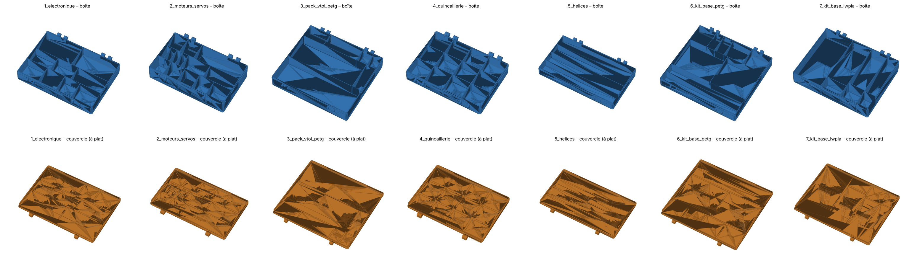
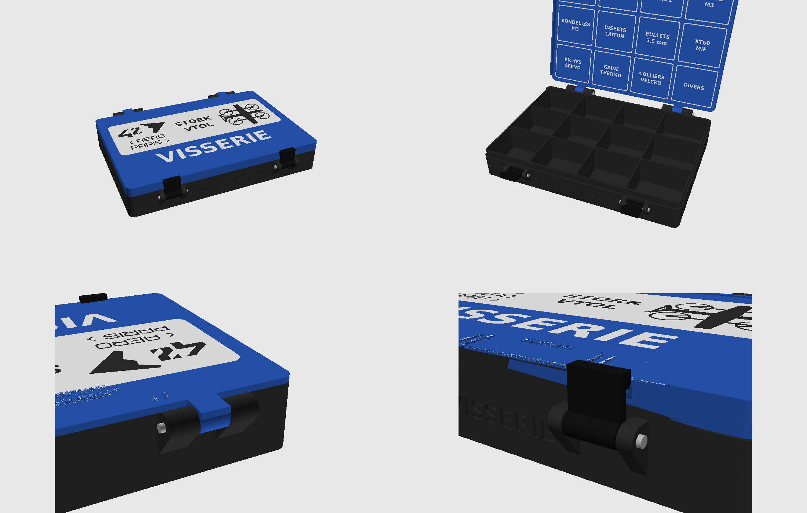
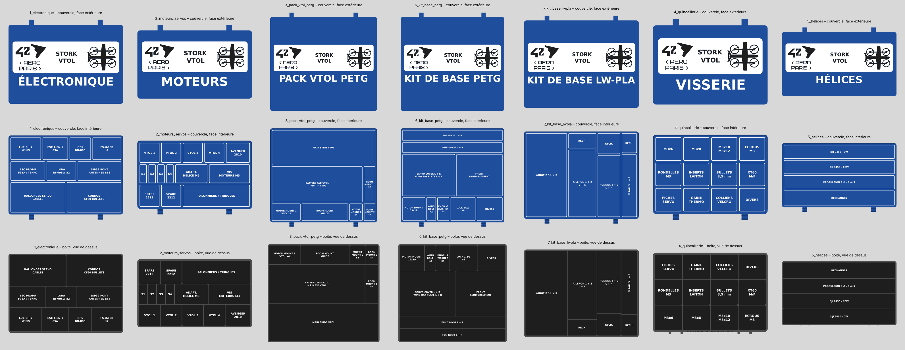

# Fiche – Boîtes de rangement Stork VTOL (prototype n°1)

| | |
|---|---|
| **Projet** | 42 AERO PARIS – Stork VTOL, prototype n°1 |
| **Objet** | 7 boîtes compartimentées avec couvercle à charnière et 2 loquets |
| **Référence** | BOM v1 (21 oct.) et STL Stork VTOL / Flightory |
| **Matière** | PLA Matte ou PETG |
| **Couleurs** | 1 couleur (STL) ou 3 couleurs (3MF : noir / bleu / blanc) |
| **Imprimante** | Toute imprimante FDM, plateau ≥ 250 × 240 mm (testé : Bambu X1C, Neptune 4 Plus) |
| **Visserie** | Par boîte : 2 vis M3 × 35, 2 vis M3 × 30, 4 écrous M3 |
| **Sources** | `generer_boites.py`, `fermeture.py`, `decor.py` |

---

## 1. Composition

| Boîte | Boîte (mm, avec charnière et oreilles) | Couvercle (mm) | Cases | Contenu |
|---|---|---|---|---|
| 1_electronique | 226 × 173 × 36 | 226 × 168 × 9 | 9 | TBS Lucid H7 Wing, ESC 4-en-1 65A, GPS BN-880, 2× FS-iA10B, ESC propulsion F35A/Tekko32, LoRa RFM95W ×2, ESP32 + antennes 868, rallonges servo, condos/XT60/bullets |
| 2_moteurs_servos | 208 × 141 × 44 | 208 × 136 × 9 | 14 | 4× 2212 VTOL, Avenger 2810, 4 servos ES08MA II, adaptateurs d'hélice M5, visserie moteurs, 2× 2212 de rechange, palonniers/tringles |
| 3_pack_vtol_petg | 250 × 238 × 42 | 250 × 232 × 9 | 7 | Pack VTOL : main skids, battery pad + fin tip, motor mounts 1 ×4 et 2 ×4, boom mounts 1 ×4 et 2 ×4, boom mount guide |
| 4_quincaillerie | 182 × 143 × 29 | 182 × 138 × 9 | 12 | M3×6, M3×8, M3×10/12, écrous, rondelles, inserts, bullets 3,5 mm, XT60, fiches servo, gaine thermo, colliers/velcro, divers |
| 5_helices | 250 × 157 × 32 | 250 × 152 × 9 | 4 | DJI 9450 CW, DJI 9450 CCW, propulsion 9×6 / 9×4,5, rechanges (hélice 9,4" = 239 mm) |
| 6_kit_base_petg | 242 × 237 × 34 | 242 × 232 × 9 | 9 | Kit de base PETG : fus root L+R, wing root L+R, servo covers + wing bay plates L+R, front reinforcement, motor mount 19×19, wing bolts ×2, knobs ×2 + washers ×4, locks 1/2/3 ×6, divers |
| 7_kit_base_lwpla | 244 × 203 × 46 | 244 × 198 × 9 | 7 | Kit de base LW-PLA (rechanges fragiles) : wingtips 3 L+R, ailerons 1 et 2 L+R (×4 empilés), rudders 1 et 2 L+R (×4 empilés), V tail 3 L+R, rechanges |
| loquets | 17,8 × 6,8 × 14 | | | 2 par boîte, identiques pour toutes |

Notes de conception :
- Les cases des boîtes 3, 6 et 7 sont dimensionnées sur les STL Flightory (boîte englobante minimale de chaque pièce + 4 à 6 mm de marge).
- Les cases des boîtes 1, 2, 4 et 5 sont estimées d'après les fiches produits (ESC notamment) : à vérifier au pied à coulisse (voir §6).
- Boîte 3 compactée pour tenir sur le plateau : le fin tip se range avec le battery pad, la visserie VTOL va dans la boîte 4.
- Boîte 7 réorganisée en empilant les pièces de rechange et tournée de 90° pour mettre la charnière sur le grand côté.

**Non rangés en boîte (trop grands)** : fuselage (FUS 1 à 6, jusqu'à 215 × 176 × 130 mm), ailes (WING 1 à 3, WING 1.1/1.2 VTOL, jusqu'à 226 × 222 mm), V TAIL 1 et 2, hatches front et middle (jusqu'à 140 × 114 × 53 mm), nose et nose gimbal (103 × 94 × 87 mm).

---

## 2. Fichiers

| Dossier / fichier | Usage |
|---|---|
| `stl/` | Une couleur, textes gravés en creux. Pour toute imprimante (Neptune 4 Plus, etc.) |
| `3mf_bambu_tricolore/` | Trois couleurs, pièces déjà affectées aux emplacements AMS. Bambu Studio |
| `*_boite` / `*_couvercle` | Un fichier par pièce |
| `loquets_x2` / `loquets_x14` | 2 loquets (une boîte) / 14 loquets (les 7 boîtes) |

---

## 3. Fermeture : charnière + loquets

- **Charnière arrière** : 2 groupes de 3 charnons (boîte / couvercle / boîte), axe Ø3 mm. Ouverture jusqu'à environ 180°. À l'arrière, la jupe du couvercle est supprimée : c'est la charnière qui le centre.
- **2 loquets avant** : pièces séparées qui pivotent sur 2 oreilles de la boîte et s'accrochent sur un ergot du couvercle, encliquetage de 0,3 mm. Pour ouvrir, tirer le haut du loquet vers soi.
- **Visserie par boîte** : 2 vis M3 × 35 + 2 écrous M3 (charnière), 2 vis M3 × 30 + 2 écrous M3 (loquets). Une tige Ø3 mm coupée à 31 mm et collée aux deux bouts peut remplacer la vis de charnière.
- **Visserie pour les 7 boîtes** : 14 vis M3 × 35, 14 vis M3 × 30, 28 écrous M3.
- Contrôlé en simulation sur les 7 boîtes : aucune interférence couvercle fermé, ouverture libre de 0 à 180°, loquets libres en rotation.

---

## 4. Impression

### Paramètres communs
| Paramètre | Valeur |
|---|---|
| Matière | PLA Matte ou PETG |
| Buse / couches | 0,4 mm / 0,2 mm |
| Parois | 3 |
| Dessus / dessous | 4 couches |
| Remplissage | 15 % gyroïde |
| Supports | Aucun |
| Orientation boîte | Posée sur son fond |
| Orientation couvercle | Tel quel, face extérieure sur le plateau |
| Orientation loquets | Debout, posés sur leur profil, trou de vis vertical |

**Pièce test** : imprimer d'abord la boîte 4 (la plus petite) avec 2 loquets et vérifier l'ajustement avant de lancer les autres.

### Variante une couleur (`stl/`)
Tous les textes sont gravés en creux. Importer les STL dans n'importe quel trancheur avec les paramètres ci-dessus.

### Variante trois couleurs (`3mf_bambu_tricolore/`)

| Pièce | Couleur | Emplacement AMS | Filament conseillé |
|---|---|---|---|
| Boîte, loquets | Noir | 1 | Bambu PLA Matte Charcoal |
| Couvercle | Bleu | 2 | Bambu PLA Matte Marine Blue |
| Textes, badge | Blanc | 3 | Bambu PLA Matte Ivory White |

Décor :
- **Face extérieure du couvercle** : badge blanc avec le logo 42 AERO PARIS, « STORK VTOL » et un quadplane en noir ; dessous, le nom de la boîte en grand, en blanc.
- **Face intérieure du couvercle** : le nom de chaque case en blanc, juste au-dessus de sa case. Couvercle ouvert, le plan est inversé avant-arrière, comme un miroir de la boîte.
- **Fond des cases** : le nom de chaque case en blanc.
- Incrustations de 0,6 mm d'épaisseur, à fleur de la surface ; textes d'au moins 4,5 mm de haut. Le titre sur la face avant de la boîte reste gravé en creux, dans le noir.

Procédure :
1. Charger l'AMS : **1 = noir, 2 = bleu, 3 = blanc**.
2. Ouvrir le .3mf dans Bambu Studio. Si un message indique que le fichier ne vient pas de Bambu Studio, accepter de charger la géométrie.
3. Les pièces sont déjà affectées : vérifier dans la liste des objets, à gauche (« Synchroniser l'AMS » si besoin).
4. Profil 0,20 mm Standard + paramètres communs. Option conseillée : *Purger dans le remplissage des objets*.
5. **Tour de purge** : sur les boîtes et couvercles 3 et 6, il ne reste que 6 à 24 mm de libre sur le plateau. Réduire la largeur de la tour (20 mm) ou la désactiver : la couleur ne change que sur quelques couches.

### Consommation estimée (7 boîtes, 7 couvercles, 14 loquets, tricolore)
| Noir | Bleu | Blanc |
|---|---|---|
| ≈ 1,3 kg (prévoir 2 bobines) | ≈ 620 g | ≈ 65 g |

---

## 5. Ajustements

| Symptôme | Correction |
|---|---|
| Couvercle trop serré | `JEU = 0.3` dans `generer_boites.py`, puis relancer |
| Couvercle trop lâche | `JEU = 0.15`, puis relancer |
| Loquet trop dur à fermer | Poncer légèrement le bec |
| Loquet trop mou | Réduire `JEU` ou augmenter `SERRAGE` dans `fermeture.py` (0,3 → 0,4), puis relancer |

---

## 6. Modifier les cases

Mesurer les composants au pied à coulisse, ajuster la liste `BOITES` dans `generer_boites.py`, puis :

    pip install manifold3d trimesh matplotlib numpy scikit-image pillow
    python3 generer_boites.py

Une largeur `"*"` prend la place restante ; la taille extérieure de la boîte ne change pas.

---

## 7. Sécurité – batteries

Pas de boîte imprimée pour les LiPo 4S : le PLA et le PETG brûlent. Les ranger dans un sac ou une caisse ignifugée, à tension de stockage (3,8 V par élément).
